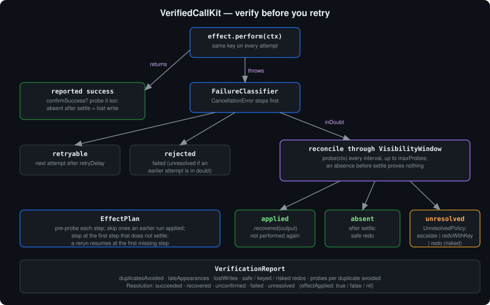
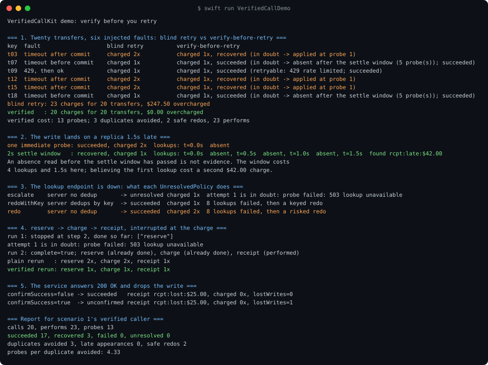
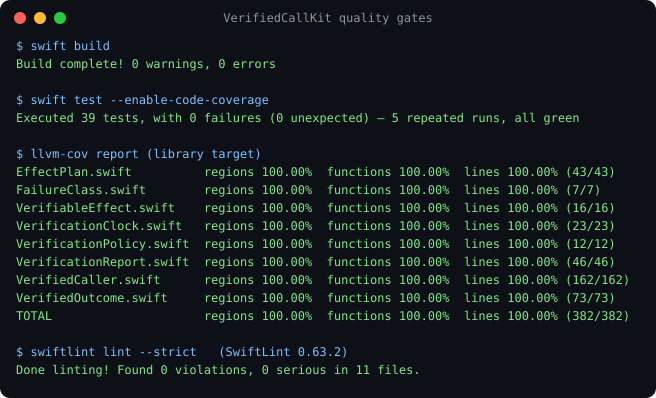

# VerifiedCallKit

A payment API times out. Your retry loop sends the request again, the first request had already
gone through, and the customer is charged twice. Retrying a timeout is right when the request never
arrived and wrong when it did, and the error alone does not tell you which.

`VerifiedCallKit` looks before it retries. Each failure is classified first. One that provably did
not take effect (a 429, a 400) is retried or given up on as usual. One that **may** have taken
effect (a timeout after the request left, a connection that dropped mid-response) is **in doubt**,
and the effect's own read-only probe settles it before anything is sent again:

- **found applied**: the probe's result comes back as `.recovered`, and the effect is not performed again;
- **absent once the settle window has passed**: performing it again is safe;
- **still unsettled**: your `UnresolvedPolicy` decides whether to escalate or redo.

The design follows *Verified Tool Calls Improve LLM Agent Reliability Under Non-Atomic Failures*
([arXiv 2608.02645](https://arxiv.org/abs/2608.02645)), which names three non-atomic failures (timeouts
after dispatch, delayed visibility and partial state updates) and answers them with postcondition
checks, verify-before-retry and idempotency keys. This package implements all three answers, with a
visibility window for the delayed-visibility case.

```
swift build   ✅  0 warnings, 0 errors
swift test    ✅  39 tests, 0 failures (5 repeated runs)
llvm-cov      ✅  100.00% lines (382) · regions (203) · functions (71)
swiftlint     ✅  0 violations (--strict, 0.63.2)
```



## Where it sits

Part of the Swift LLM ecosystem around
[`ProviderGatewayKit`](https://github.com/rajatslakhina/foundation-model-provider-gateway).

| Package | Question it answers |
|---|---|
| [`RetryPolicyKit`](https://github.com/rajatslakhina/retry-policy-kit) | *When* should a failed call be tried again? |
| [`IdempotencyKit`](https://github.com/rajatslakhina/idempotency-kit) | Has this exact request been handled already, here? |
| [`OutcomeMonitorKit`](https://github.com/rajatslakhina/outcome-monitor-kit) | Is a successful result the shape of a real answer? |
| **`VerifiedCallKit`** | **Did a failed call take effect anyway, and is it safe to send it again?** |

`IdempotencyKit` freezes a key when an effect fails in doubt, and its `EffectResolution` type is
documented as the way "an operator or reconciler settles a key frozen by an indeterminate failure".
`VerifiedCallKit` is that reconciler: a `.recovered` outcome maps to `.applied(result)`, and an
in-doubt attempt the probe found absent maps to `.notApplied`.

## Install

```swift
.package(url: "https://github.com/rajatslakhina/verified-call-kit.git", from: "1.0.0")
```

Swift 6 toolchain, Swift 5.10 language mode, strict concurrency. macOS 13, iOS 16, tvOS 16, watchOS 9.
No dependencies.

## Usage

### Describe the effect and how to look for it

```swift
import VerifiedCallKit

let transfer = ClosureEffect<String>(
    key: "transfer-8841",                        // the same on every attempt and every run
    perform: { context in
        try await api.postTransfer(id: context.key, cents: 4_200)   // send the key if the API dedups
    },
    probe: { context in
        guard let row = try await api.findTransfer(id: context.key) else { return .absent }
        return .applied(row.receipt)
    }
)
```

The probe must be read-only and must look up by `context.key`, not by attempt. A conclusive absence
is taken to mean that no attempt under this key took effect.

### Say which failures are in doubt

```swift
let classifier = FailureClassifier { error in
    switch error {
    case APIError.rateLimited: return .retryable     // never reached the service
    case APIError.badRequest:  return .rejected      // never will
    default:                   return .inDoubt       // may have committed
    }
}
```

`FailureClassifier.conservative` treats every error as in doubt. `CancellationError` never reaches
the classifier: a cancelled attempt ends the call as `.unresolved` without a retry or a probe.

### Run it

```swift
let caller = VerifiedCaller(
    policy: VerificationPolicy(
        maxAttempts: 3,
        window: VisibilityWindow(settle: .seconds(2), interval: .milliseconds(500), maxProbes: 8),
        onUnresolved: .escalate,
        confirmSuccess: false
    ),
    classifier: classifier
)
let outcome = await caller.execute(transfer)

switch outcome.resolution {
case .succeeded(let receipt), .recovered(let receipt): show(receipt)
case .failed(let reason):      showError(reason)          // nothing was charged
case .unresolved(let reason):  askOperator(reason)        // maybe charged; do not guess
case .unconfirmed(_, let why): flagForReview(why)         // "success" that no probe could see
}
```

`outcome.attempts` records a verdict per attempt (`retryable`, `inDoubtApplied`, `inDoubtAbsent`,
`inDoubtUnresolved`, ...), and `outcome.resolution.effectApplied` is `true`, `false` or `nil` when
nobody knows.

### The visibility window

A probe that reads a replica can miss a write the primary has already acknowledged. An absence read
before `settle` has passed proves nothing, so the caller keeps probing every `interval`, up to
`maxProbes`. `VisibilityWindow.immediate` (one probe, believed at once) is right for a store with
read-your-writes consistency. Anywhere else it turns delayed visibility into duplicates, and the demo
shows this happening.

### When the probe cannot answer

| `UnresolvedPolicy` | What it does | Use it when |
|---|---|---|
| `.escalate` (default) | Stops with `.unresolved` | Money, messages, anything a person must not get twice |
| `.redoWithKey` | Performs again with the same key | The service deduplicates by key |
| `.redo` | Performs again, counted as a risked redo | A duplicate is cheap and a missing effect is not |

### Plans that stop halfway

```swift
let order = EffectPlan(name: "order-17", steps: [reserve, charge, receipt])
let result = await caller.execute(plan: order)
// result.completed, result.stoppedAt, result.stop?.resolution
```

Each step is probed before it runs, and a step an earlier run already applied is skipped
(`alreadyApplied == true`). A rerun of an interrupted plan resumes at the first missing step instead
of reserving and charging again. Nothing is rolled back; this is not a saga. Resume only once the
settle window has passed since the interrupted run, or a pre-probe can miss a write that is not
visible yet.

### Confirm successes too

With `confirmSuccess: true`, a reported success is probed as well. A success whose effect is still
absent after the settle window is `.unconfirmed` and counted as a lost write.

### Report

```swift
let report = await caller.report()
report.duplicatesAvoided      // in-doubt attempts found applied: a blind retry repeats each one
report.lateAppearances        // of those, the ones a single immediate probe would have missed
report.lostWrites             // acknowledged successes that never became visible
report.safeRedos, report.keyedRedos, report.riskedRedos
report.probesPerDuplicateAvoided
```

## Demo

`swift run VerifiedCallDemo` runs five scenarios against a simulated transfer API with injected
failures, on a virtual clock. The output below was captured from a real run
(`Screenshots/demo-output.txt`) and is byte-identical across runs.



1. **Twenty transfers, six faults.** A plain retry loop makes 23 charges and overcharges $247.50
   (three timeouts that had already committed). Verify-before-retry makes 20 charges and overcharges
   nothing. It costs 13 probes: one each for the three committed timeouts, and five each for the two
   timeouts that never committed, because confirming an absence means waiting out the 2-second window.
2. **A replica 1.5 s behind.** One immediate probe reads "absent" and charges $42.00 twice. The
   settle window reads absent at 0.0 s, 0.5 s and 1.0 s, finds the transfer at 1.5 s, and charges once.
3. **The lookup endpoint is down.** `escalate` stops with the charge made once and the outcome
   unknown. `redoWithKey` against a server that deduplicates charges once. `redo` against one that
   does not charges twice and is counted as a risked redo.
4. **A plan interrupted at the charge.** A plain rerun reserves twice and charges twice. The verified
   rerun finds `reserve` and `charge` already done and only sends the receipt.
5. **200 OK, write lost.** Without confirmation the call reports `succeeded` while nothing was
   charged. With `confirmSuccess` it is `unconfirmed`, with `lostWrites = 1`.

## What it cannot do

- **No probe, no verification.** If the service offers no read-only way to look an effect up by key,
  every in-doubt failure is unresolved and the policy decides. The package does not invent certainty.
- **The probe has to be right.** A probe that looks up by attempt, or reads a cache, will report
  absences that are false. The settle window handles lag; it cannot fix a wrong lookup.
- **No rollback.** A plan that stops leaves its earlier steps done. Compensation is your code.
- **Timing is yours to choose.** A settle window shorter than the store's real lag still duplicates.
  Measure the lag; the report's `lateAppearances` shows how often you are close to it.

## Quality gates



All gates were run with real tools on macOS with Swift 6.2.4:

- `swift build`: 0 warnings, 0 errors.
- `swift test --enable-code-coverage`: 39 tests, 0 failures, green on 5 repeated runs. This includes
  100 concurrent effects through one actor, all counted, and a control test where classifying a
  timeout as retryable commits the same transfer twice.
- `llvm-cov report`: **100.00%** lines, regions and functions on all 8 library files with executable
  code (382 lines). `ProbeReading.swift` declares an enum only.
- `swiftlint lint --strict` (SwiftLint 0.63.2): 0 violations.

## License

MIT
